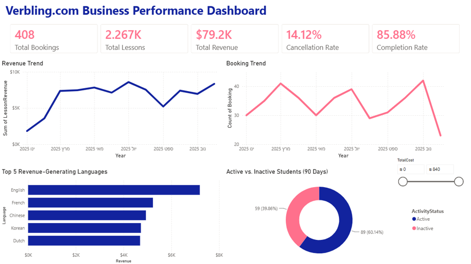
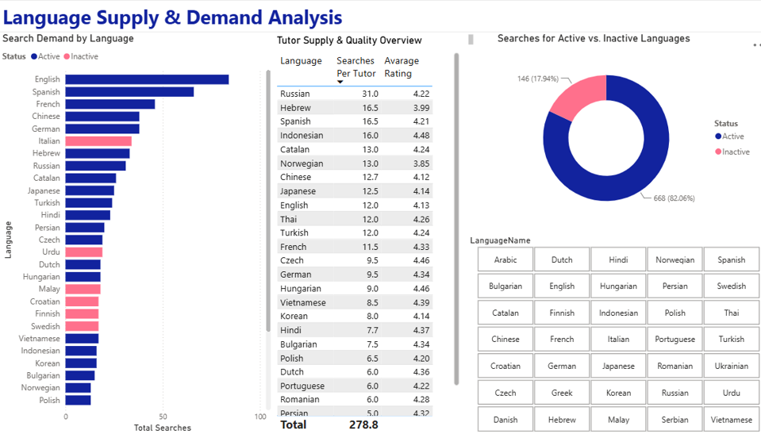

# Language Learning Marketplace | SQL & Power BI Analytics

### End-to-End Database Design, SQL Analytics & Business Intelligence

## Project Overview

This project demonstrates the design and analysis of a relational database for an online language-learning marketplace, inspired by platforms that connect students with private language tutors.

The project covers the process from database architecture and SQL-based business logic to data analysis and interactive reporting in Microsoft Power BI.

The goal is to transform operational data into meaningful business insights that support decision-making, performance monitoring, and marketplace optimization.

**Technologies:** Microsoft SQL Server | T-SQL | SQL Server Management Studio (SSMS) | Power BI | Excel

---

## Business Context

The simulated platform enables students to search for tutors, book language lessons, manage their learning progress, and provide feedback.

From a business perspective, the marketplace needs to understand:

- **Revenue Performance:** How much revenue is generated from completed lessons?
- **Supply and Demand:** Which languages experience the highest demand relative to available tutors?
- **Tutor Performance:** How do tutor ratings, pricing, and lesson activity vary?
- **Student Engagement:** Which students are active, and how can inactivity be identified?
- **Operational Efficiency:** How can booking management and pricing calculations be automated?

The database and analytical components were designed to address these questions.

## Project Architecture

The project consists of three main components:

### 1. Relational Database Design

A structured SQL database was designed to represent the marketplace's core business entities and relationships.

The data model includes:

| Entity | Description |
|---|---|
| Users | General user information |
| Students | Student profiles |
| Tutors | Tutor profiles and hourly rates |
| Languages | Available learning languages |
| Lessons | Lesson scheduling, duration, and status |
| Bookings | Student reservations and payment information |
| Reviews | Student ratings and feedback |
| Teaching | Languages and proficiency levels offered by tutors |
| Studying | Students' current and target language levels |

The database incorporates primary and foreign keys, validation constraints, lookup tables, and relational integrity rules.

### 2. SQL Analytics & Business Logic

Advanced T-SQL techniques were implemented to analyze marketplace activity and support operational processes.

**Analytical SQL techniques:**

- Multi-table joins and aggregations
- Nested queries and Common Table Expressions (CTEs)
- Window functions, including `ROW_NUMBER`, `RANK`, `DENSE_RANK`, `LAG`, `LEAD`, and `NTILE`
- Revenue and customer segmentation analysis
- Supply-and-demand analysis by language

**Business logic implementation:**

- **Views:** Reusable datasets for tutor searches and reporting.
- **Scalar Function:** Evaluation of compatibility between student and tutor proficiency levels.
- **Table-Valued Function:** Tutor filtering by language and maximum hourly rate.
- **Trigger:** Automatic recalculation of booking costs when lesson records change.
- **Stored Procedure:** Booking cancellation logic that prevents cancellation of bookings containing completed lessons.

**Query optimization:**

Indexes and query restructuring were used to explore ways to improve analytical query performance and efficiency.

### 3. Power BI Reporting

Microsoft Power BI was used to develop a visual reporting layer for analyzing the marketplace's business performance.

Dedicated SQL views were created to support the reporting process, including:

- `vw_LanguageSupplyDemand`
- `vw_LanguagePerformance`
- `vw_LessonRevenue`
- `vw_StudentActivity`

These views provide structured data for analyzing revenue, language demand, tutor availability, customer activity, and service quality.

---

## Power BI Dashboard

### Business Performance Overview

This section presents the marketplace's overall business performance and key operational indicators.

**Dashboard Screenshot**

[Insert Power BI Business Overview Screenshot Here]

Suggested file path: `images/business-overview.png`

### Language Supply & Demand Analysis

This analysis focuses on understanding the relationship between student demand and tutor availability across different languages.

Key metrics include:

- Total searches by language
- Number of available tutors
- Average searches per tutor
- Language availability status

These metrics can help identify potential supply shortages and opportunities to expand tutor availability.

**Dashboard Screenshot**

[Insert Power BI Supply & Demand Screenshot Here]

Suggested file path: `images/language-analysis.png`

### Student Activity & Revenue Analysis

This section focuses on understanding student engagement and the financial performance of completed lessons.

Key analytical measures include:

- Revenue generated from completed lessons
- Student activity classification
- Time since a student's most recent booking
- Revenue patterns across the marketplace

Students are classified as active or inactive based on whether their latest booking falls within a 90-day window relative to the most recent booking date in the dataset.

**Dashboard Screenshot**

### Power BI Dashboard

<p align="center">
  
</p>

### Power BI Report

<p align="center">
  
</p>

---

## Key Technical Highlights

| Area | Implementation | Business Value |
|---|---|---|
| Database Design | Relational schema, keys, and constraints | Structured and consistent data |
| Advanced SQL | CTEs, subqueries, and window functions | Deeper business analysis |
| Business Logic | Functions, triggers, and stored procedures | Automated operational processes |
| Business Intelligence | SQL reporting views and Power BI | Accessible business insights |
| Performance Optimization | Indexing and query restructuring | More efficient data retrieval |

## Repository Structure

```text
language-learning-sql-bi/
│
├── 01_database_schema.sql
├── 02_analytics_and_logic.sql
├── data.xlsx
├── PowerBI.pbix
├── README.md
│
└── images/                    # To be added
    ├── business-overview.png
    ├── language-analysis.png
    └── student-revenue.png
```

**File descriptions:**

- `01_database_schema.sql` — Database tables, relationships, constraints, and sample data.
- `02_analytics_and_logic.sql` — Analytical queries, business logic, reporting views, and optimization examples.
- `data.xlsx` — Excel data file included in the project.
- `PowerBI.pbix` — Power BI report file.

## Tools & Skills Demonstrated

**Database Development**
- Relational database modeling
- Data integrity and constraints
- SQL Server and T-SQL

**Data Analysis**
- Advanced SQL queries
- Aggregations and window functions
- Revenue and engagement analysis
- Customer segmentation

**Business Intelligence**
- Data preparation for reporting
- KPI development
- Power BI dashboard creation
- Business-oriented data visualization

**Problem Solving**
- Translating business requirements into technical solutions
- Implementing database-level business rules
- Query optimization and performance considerations

## How to Explore the Project

1. Review `01_database_schema.sql` to understand the relational database structure.
2. Explore `02_analytics_and_logic.sql` for analytical queries, functions, triggers, stored procedures, and reporting views.
3. Open `PowerBI.pbix` using Microsoft Power BI Desktop to explore the report.
4. Review the dashboard screenshots above for a visual overview of the analysis.

**Note:** The project uses simulated marketplace data for educational and analytical purposes. The SQL files contain development and demonstration scripts and may require adjustments to run sequentially against a fresh database.

---

## Project Takeaways

This project demonstrates the integration of database development, analytical SQL, and business intelligence into a single data analytics workflow.

It highlights the ability to design a relational data model, implement business rules, extract meaningful information through SQL, and present analytical results through Power BI.

The project emphasizes both technical implementation and the translation of data into insights that can support business decisions.
